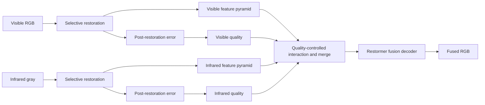

# ReQFuse

**Selective Restoration and Post-Restoration Quality-Guided Infrared–Visible Image Fusion**

ReQFuse 是面向退化输入的红外–可见光图像融合实验项目。方法先在各自模态内恢复图像，再估计恢复后的残留误差，用质量信息控制多尺度融合中的源特征与跨模态消息。网络使用 Restormer 风格的 MDTA/GDFN，输出 RGB 融合图像。

当前实现版本为 `restormer_v2`，默认参数量 **8,725,358**。仓库提供训练、推理、人工退化生成与功能测试代码；数据集、模型权重和实验产物由使用者在本地准备。当前版本处于实验阶段，完整融合性能以实际训练结果为准。

## 方法概览



两个关键模块独立实现：

| 模块 | 作用 | 文件 |
|---|---|---|
| 选择性同模态恢复 | 预测修改需求，生成有界残差，尽量保留完整区域 | [model/restoration.py](model/restoration.py) |
| 恢复后质量控制 | 估计残留误差，以源质量控制局部窗口内的通道交叉注意力及特征合并 | [model/quality.py](model/quality.py) |

完整网络由 [model/fusion.py](model/fusion.py) 组织。两路恢复器各使用三层金字塔；融合网络使用四层金字塔、单个融合编码器/解码器，在默认第3、4尺度进行双向交互。采样和通用块放在 [model/blocks.py](model/blocks.py)。当前上采样采用 PixelShuffle。

恢复结果写作 `restored = input + applied_demand × residual`。需求输出为 sigmoid 概率；残差使用 tanh 约束。恢复后误差头回归归一化量 `u`，转换为 `e = 0.1 × ReLU(u)`，再通过 `q = exp(-e / 0.1)` 得到质量。两路质量独立估计，不强制相加等于1。

HQ 原图与退化掩码只参与训练监督和有参考的诊断；**正常推理只输入 VI/IR 图像对**。

## 环境与安装

建议使用 Python 3.10 或更新版本；当前功能检查环境为 Python 3.12、PyTorch 2.14。主要依赖为 PyTorch、NumPy、Pillow、tqdm、Matplotlib 和 OpenCV，版本下限见 [requirements.txt](requirements.txt)。

```bash
git clone git@github.com:kunzhou357/ReQFuse.git
cd ReQFuse
python -m pip install -r requirements.txt
```

CUDA 训练需要安装与设备匹配的 PyTorch CUDA 发行版。训练入口自动选择 CUDA、MPS 或 CPU：CUDA 优先使用 BF16，不支持时使用 FP16；CPU/MPS 默认关闭混合精度。自动选择设备不代表所有设备都已完成性能或兼容性验证。

下文命令均在仓库根目录执行。本地目录名可以是 `ReQFuse`、`Ours` 或其他名称。

## 数据准备

输入为已配准的 RGB 可见光与灰度红外图像对。MSRS 等公开数据集原图在本项目中统一作为干净/HQ 参考。数据集不随仓库分发。

推荐布局：

```text
data/
  train/
    vi/
      scene_001.png
    ir/
      scene_001.png
  test/
    vi/
      scene_101.png
    ir/
      scene_101.png
```

- 路径直接指向图片目录，名称可以是 `vi`、`vis`、`visible`、`ir` 或 `thermal` 等。
- 相对路径以仓库根目录为基准，也支持绝对路径。
- 配对键为“相对目录 + 去掉扩展名后的文件名”；两路扩展名可以不同，子目录和样本 ID 必须对应。
- 同一对图像必须具有相同空间尺寸。缺失配对、重复 ID 或尺寸不一致时会报错。
- 支持 PNG、JPEG、BMP、TIFF；VI 转为 RGB，IR 转为灰度，浮点输入范围为 `[0,1]`。

所有提供的训练图像对都用于训练。项目不自动划分验证集，也不按验证指标选择 checkpoint。

## 训练

修改 [train.py](train.py) 顶部的手动设置，然后直接运行文件。无需 YAML 配置或终端数据参数。

```python
VISIBLE_DIR = "data/train/vi"
INFRARED_DIR = "data/train/ir"
OUTPUT_DIR = "outputs/restormer_v2"

BATCH_SIZE = 4
PATCH_SIZE = 128
TOTAL_STEPS = 30000
LEARNING_RATE = 2e-4
RESUME_TRAINING = False

ONLINE_DEGRADATION = True
HQ_VISIBLE_DIR = None
HQ_INFRARED_DIR = None
```

```bash
python train.py
```

### 两种数据来源

**在线合成：** `ONLINE_DEGRADATION=True`。VI/IR 目录存放 HQ 原图，训练时同步裁剪/变换后生成退化，HQ 目录无需填写。

当前在线池位于 [utils/degradation.py](utils/degradation.py)：VI 为噪声、模糊、对比度变化、曝光变化；IR 为噪声、模糊、对比度变化。干净/仅VI/仅IR/双模态条件的采样概率为 `0.2/0.3/0.3/0.2`，局部退化概率为 `0.7`。

**已有退化对：** `ONLINE_DEGRADATION=False`。VI/IR 指向退化输入，并填写两路对应 HQ 目录：

```python
ONLINE_DEGRADATION = False
VISIBLE_DIR = "data/degraded/train/vi_low_light__ir_clean/local/medium/vi"
INFRARED_DIR = "data/degraded/train/vi_low_light__ir_clean/local/medium/ir"
HQ_VISIBLE_DIR = "data/train/vi"
HQ_INFRARED_DIR = "data/train/ir"
```

训练入口自动发现输入目录旁生成器提供的 `mask_vi/`、`mask_ir/` 并检查配对。只存在其中一个目录时会报错；没有区域掩码的普通外部退化对按全图受损处理，不施加完整区保持项。

**在线池与下文的九类离线生成器是两个独立入口。生成离线数据不会自动切换在线训练分布。**

### 默认训练策略

| 设置 | 默认值 |
|---|---|
| 裁剪 / micro-batch | `128 × 128` / `4` |
| 梯度累积 / 有效 batch | `2` / `8` |
| 优化器 | AdamW，学习率 `2e-4`，weight decay `1e-4` |
| 总更新次数 | `30,000` 次 optimizer 更新 |
| 恢复启动 / 联合渐入 | `2,142` / `2,142` 步 |
| 学习率 warmup | `428` 步，随后余弦衰减 |
| 日志 / 预览与曲线 / 权重 | 每 `100` / `500` / `2,000` 步 |

以上预算随 `TOTAL_STEPS` 自动缩放。先观察6k更新效果时，保留30k计划并检查6k权重与预览；直接把总步数改为6k会同时改变 warmup、联合渐入和学习率计划。128阶段稳定后可将正式实验裁剪改为256，并根据显存调整 batch。

恢复启动阶段实际应用需求为1，使残差获得学习信号；联合阶段以 `(1-rho) + rho × demand.detach()` 逐渐启用预测需求。需求始终接受独立监督，恢复/融合损失不会通过关闭需求门直接降低损失。融合损失及质量控制按同一进度渐入；正式推理使用完整预测门。

### 损失

融合监督只使用四项常规损失，目标来自 HQ 源图：

| 分项 | 定义 | 训练权重 |
|---|---|---:|
| 强度 | 融合亮度与两源最大亮度的 L1 | 10 |
| 梯度 | 原始 Sobel 幅值与两源最大梯度的 L1 | 2 |
| SSIM | 与两源亮度分别计算，等权平均 | 1 |
| Color | 保留可见光 Cb/Cr 色度 | 1 |

[utils/loss.py](utils/loss.py) 是可移植的四项融合损失实现，其类默认权重保持通用设置；上表配方由训练入口内部设定。

[utils/auxiliary_loss.py](utils/auxiliary_loss.py) 单独处理恢复重建、完整区保持、需求与残留误差监督，默认权重为 `5/2/1/1`。恢复像素项、需求和误差按每张图的受损区/完整区分别平均；空区域显式处理。需求直接监督 logits，误差直接监督 ReLU 之前的线性回归量，避免在饱和激活之后计算状态损失。

### 续训

将 `RESUME_TRAINING=True`，保持原训练参数与数据，重新运行 `train.py`，自动读取 `OUTPUT_DIR/last.pth`。checkpoint 保存模型、优化器、scaler、随机状态、调度位置和数据采样游标，严格检查实现版本、参数及数据指纹。

当前 v2 需要从头训练；v1 checkpoint 不能作为无缝续训输入。旧权重应使用其对应代码版本复现。

## 推理与评估

修改 [test.py](test.py) 顶部设置：

```python
VISIBLE_DIR = "data/test/vi"
INFRARED_DIR = "data/test/ir"
CHECKPOINT_PATH = "outputs/restormer_v2/last.pth"
OUTPUT_DIR = "outputs/inference_v2"

USE_HQ_REFERENCE = False
HQ_VISIBLE_DIR = None
HQ_INFRARED_DIR = None
```

```bash
python test.py
```

推理不需要 HQ；网络从 checkpoint 读取规格。任意尺寸输入在内部补齐后恢复原尺寸，导出的 RGB/gray 图像不缩放。需要评估同模态恢复时，将 `USE_HQ_REFERENCE=True` 并填写两路 HQ 目录。

无 HQ 时输出 EN/SD/SF 描述统计；有 HQ 时额外输出两路恢复 PSNR/SSIM/MAE、误差估计 MAE 和四项融合监督分量。项目不将某一个源模态视为融合真值来计算融合 PSNR。恢复指标使用浮点结果；图像保存时才 clamp 与8-bit量化。

## 人工退化数据生成

[generate_degradation.py](generate_degradation.py) 用于可重复地生成配对退化图像。修改脚本顶部设置，两路路径指向 HQ 原图：

```python
VISIBLE_DIR = "data/train/vi"
INFRARED_DIR = "data/train/ir"
OUTPUT_DIR = "data/degraded/train"

VI_DEGRADATION = "low_light"
IR_DEGRADATION = "clean"
LEVELS = ["light", "medium", "heavy"]
GLOBAL_DEGRADATION = True
GENERATE_ALL_TYPES = False

DEPTH_DIR = None
DEPTH_IS_INVERSE = True
```

```bash
python generate_degradation.py
```

- VI：`clean / low_light / noise / blur / rain / snow / haze`。
- IR：`clean / noise / stripe / low_contrast`。
- `GENERATE_ALL_TYPES=True` 一次生成六类VI与三类IR单模态条件；False 使用指定组合，也可同时退化两路。
- `GLOBAL_DEGRADATION=False` 使用软边局部区域，主体面积约40%；双模态条件共用包络，涉及条纹时共用竖向带。
- 雾默认使用均匀距离模型；提供同名 PNG 或 `.npy` 深度图后可使用深度相关透射率。深度图须与 VI 同尺寸。

强度固定在 [utils/synthetic_degradation.py](utils/synthetic_degradation.py)。以下是本项目的三级协议，噪声标准差以8-bit单位列出：

| 条件 | light | medium | heavy |
|---|---|---|---|
| VI/IR 噪声 | Gaussian σ=5，Poisson peak=120 | σ=10，peak=80 | σ=20，peak=50 |
| VI 模糊 | 21×21，σ=1.2 | 21×21，σ=2.0 | 21×21，σ=2.6 |
| VI 低光 | γ=1.5 | γ=2.0 | γ=3.0 |
| IR 条纹 | 列 σ=3 | 列 σ=6 | 列 σ=10 |
| IR 低对比度 | α=0.8 | α=0.5 | α=0.3 |
| VI 雾 | β=0.5 | β=1.0 | β=2.0 |
| VI 雨 | 覆盖2%，opacity=0.15 | 5%，0.30 | 8%，0.45 |
| VI 雪 | 覆盖3%，opacity=0.50 | 6%，0.70 | 10%，0.85 |

低光使用平滑 max-RGB 估计照明，按 Retinex 形式衰减后在线性RGB域耦合 shot/read noise；这不是 LIME 的逐实现复现。条纹沿列相关，低对比度保留原均值。雨雪使用程序化 alpha 合成；雾的空气光为0.75、距离上限为0.7。

退化形式与部分参数参考 DSPFusion、ControlFusion 和 AMG-Fuse 的任务设置；三级组合、雨雪覆盖/透明度及部分分级值是本项目的实验协议，不声称与它们的官方数据生成过程完全相同。

生成器保留源图尺寸和样本 ID，保存未退化的一路、二值实际作用掩码、软包络及预览：

```text
data/degraded/train/vi_low_light__ir_clean/global/medium/
  vi/                  # 退化可见光或原图
  ir/                  # 退化红外或原图
  mask_vi/             # 实际作用支持
  mask_ir/
  envelope_vi/         # 软空间包络
  envelope_ir/
  previews/
  records.csv          # 每张图的来源、种子和参数
  run_info.json        # 协议、代码指纹和完整性记录
```

种子按样本 ID 稳定分配；同一条件的不同强度共用基础随机种子与区域。记录文件是自动输出，不作为配置输入。来源或参数不同的已有输出不会被静默混写。

## 输出与可视化

训练默认保存：

```text
outputs/restormer_v2/
  last.pth
  step_*.pth
  train.jsonl
  log.txt
  run_info.json
  data_manifest.json
  loss_curves.png
  state_curves.png
  previews/step_*.png
```

固定训练样本预览展示输入、恢复、融合、预测/实际应用需求、误差、质量、残差饱和位置及 HQ 参考。状态图使用固定显示范围；恢复启动阶段不显示虚构的融合结果。预览不改变训练随机状态、模型模式或数据游标。

日志包含两路恢复前后/受损区MAE、完整区修改、需求目标与预测、logits分位数、实际/预测残留误差、质量分箱、头特征标准差、残差tanh饱和比例及各状态头的参数梯度范数。参数梯度统计在 unscale 后、clip 前执行。缺失区域对应指标为0，需结合区域占比解释。

推理输出包含 `rgb/`、`gray/`、`comparisons/`、恢复与状态图、原始误差 `.pt` 张量，以及 `metrics.csv`、`summary.json`。展示图和指标不能单独替代对人物、背景纹理、源图信息保留的检查。

## 功能检查

无需真实数据即可运行：

```bash
python tests/run_tests.py
python tests/smoke.py
```

测试覆盖网络前向/反向、状态梯度隔离、极负状态输出的恢复梯度、区域损失、CPU BF16、数据配对、确定性采样、训练/续训/推理及退化生成。冒烟使用完整默认模型和合成小图；所有临时数据、日志、图像和权重只写入 `tests/`，合成权重默认在检查后清理。

需要真实训练图的小样本诊断脚本：

| 脚本 | 用途 |
|---|---|
| [tests/check_restoration_learning.py](tests/check_restoration_learning.py) | 16对训练图、250步已知噪声恢复检查；分别检查启动门与预测门 |
| [tests/check_fusion_objective_v2.py](tests/check_fusion_objective_v2.py) | 8个训练裁剪直接拟合RGB，比较两组四项损失权重的目标偏好 |

运行前在这些脚本顶部填写本地训练目录。它们是工程诊断，不使用独立验证集，也不作为完整融合方法的泛化结果。历史 `diagnose_*` / `probe_*` 脚本依赖指定输入与 checkpoint，部分用于旧版本诊断，应结合对应代码版本使用。

2026-10-08在只含仓库文件的独立副本上检查了45项功能测试：42项通过、3项因缺少CUDA/MPS跳过。完整默认模型的训练、续训与推理冒烟通过，确定性CPU续训与连续训练参数逐位一致。此前16对训练图的250步恢复检查，在预测需求门下VI/IR MAE约下降40%/56%，两路残差饱和比例为0。上述检查支持恢复路径可以学习，尚不能证明完整重训后所有人物伪影消失；RTX 4090与完整训练结果需要在实际设备上验证。

## 项目结构

```text
ReQFuse/
  train.py
  test.py
  generate_degradation.py
  requirements.txt
  model/
    fusion.py                 # 完整模型与融合主干
    blocks.py                 # Restormer及采样/轻量块
    restoration.py            # 关键模块一
    quality.py                # 关键模块二
  utils/
    dataset.py                # 配对、同步变换和可恢复采样
    loss.py                   # 四项通用融合损失
    auxiliary_loss.py         # 恢复和状态监督
    degradation.py            # 当前在线退化池
    synthetic_degradation.py  # 九类离线退化协议
    image.py                  # 图像IO和指标
    visualization.py          # 拼图与曲线
    diagnostics.py            # 训练样本诊断
    experiment.py             # 路径、日志、checkpoint及随机状态
  tests/                      # 测试与诊断源代码
```

`.gitignore` 使用代码/文档白名单。数据、checkpoint、结果、测试产物、IDE配置、缓存和本机环境变量文件均不进入版本控制。实验消融可放独立 `ablation/` 目录，每项使用完整训练文件；主训练入口保持完整方案。

## 设计参考

- [Restormer](https://github.com/swz30/Restormer)：MDTA/GDFN 与恢复网络组件。
- [AMG-Fuse](https://github.com/ixilai/AMG-Fuse)：模态处理和融合职责的组织。
- [DSPFusion](https://github.com/Linfeng-Tang/DSPFusion)：多尺度融合与退化任务设置。
- [ControlFusion](https://github.com/Linfeng-Tang/ControlFusion)：人工退化形式与参数参考。
- [CalibFuse](https://github.com/kunzhou357/CalibFuse)：手动参数入口、训练进度与结果可视化方式。

ReQFuse 是当前方法的独立实验实现，并非上述项目的官方复现。
